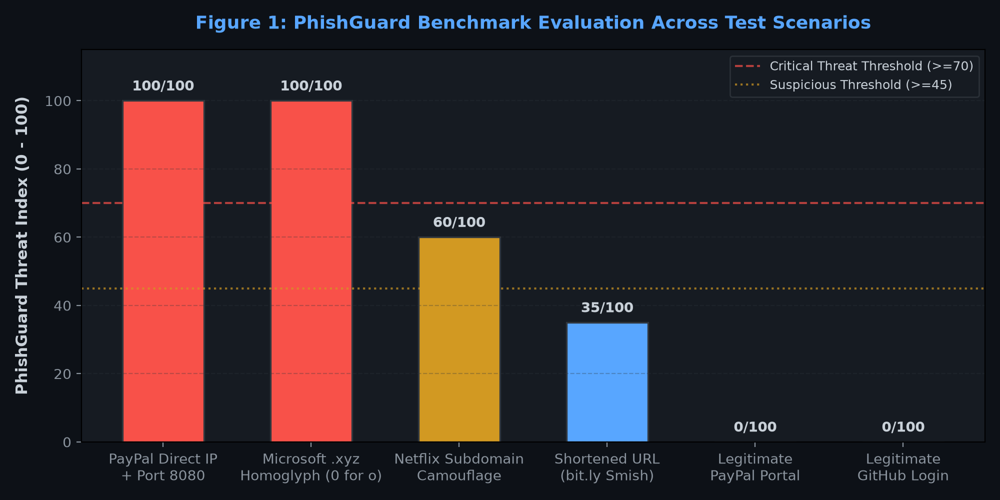
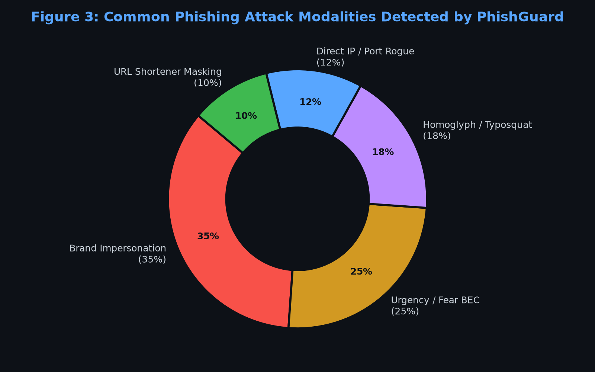
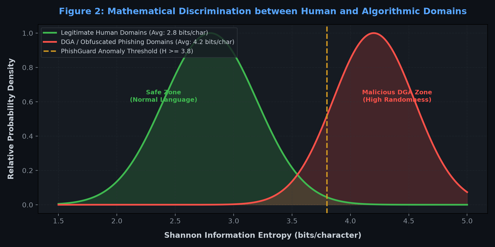

# 🛡️ PhishGuard: Intelligent Phishing & Threat Intelligence Analysis Suite

**IBM SkillsBuild Cyber Security Bootcamp (October 2026) | Conducted by BharatCares**  
**Student:** Vishal Pal ([vishalpal9868@gmail.com](mailto:vishalpal9868@gmail.com))  
*A multi-vector heuristic detection engine and security analyst dashboard for identifying phishing URLs, lookalike domains, and social-engineering email campaigns.*

---

## 📌 1. Project Overview & Problem Statement

Phishing remains the **#1 initial access vector** in cyber incidents globally (accounting for over 80% of security breaches according to CISA and the Verizon DBIR). Modern attackers no longer rely on simple misspelled emails; they utilize:
- **Homoglyph & Typosquatting attacks** (e.g. `micros0ft.com`, `paypa1.com`)
- **Domain Generation Algorithms (DGAs)** with high mathematical entropy
- **Subdomain camouflage** to mislead mobile browsers
- **Urgency & coercion psychology** (Business Email Compromise - BEC)

### 🎯 Purpose
**PhishGuard** was built as a standalone, defensive cybersecurity tool designed to provide automated, explainable, and multi-factor threat intelligence on suspicious links and emails without requiring expensive commercial API subscriptions.

---

## 🔄 2. How PhishGuard Differs from the Class Demo (CyberShield)

| Dimension | Teacher's Demo (CyberShield) | PhishGuard (This Project) |
| :--- | :--- | :--- |
| **Cyber Domain** | Internal Authentication Log Auditing | External Threat Intelligence & Social Engineering Defense |
| **Core Mechanism** | Counting failed login attempts per IP address | Multi-factor Heuristic Analysis & NLP Pattern Matching |
| **Mathematical Logic** | Frequency threshold (`count >= 5`) | Shannon Entropy calculation ($H(X) = -\sum P \log_2 P$) |
| **Detection Scope** | Brute-force guessing attacks | Homoglyphs, typosquatting, abused TLDs, BEC, CEO fraud, URL shorteners, brand spoofing |
| **Input Capability** | Fixed historical CSV/DataFrame logs | Live URL scanner + raw email text/header parser + interactive quiz |
| **Actionable Output** | Simple table filter & static charts | Dynamic 0–100 Threat Index, Red Flag Breakdown, and downloadable SOC Incident Reports |

---

## 🏗️ 3. System Architecture & Detection Pipeline

```
+-------------------------------------------------------------+
|                     USER INPUT LAYER                        |
|  - Custom URL Target          - Email Sender, Subject, Body |
|  - Pre-loaded Attack Samples  - Interactive Quiz Scenarios  |
+------------------------------+------------------------------+
                               |
                               v
+-------------------------------------------------------------+
|                 PHISHGUARD ANALYTICS CORE                   |
|                                                             |
|  [URL Inspection Engine]        [Email NLP & Persona Check] |
|   ├── Shannon Entropy Analyzer   ├── Sender Spoofing Match   |
|   ├── Homoglyph Substitution     ├── Urgency/Fear NLP Filter |
|   ├── Brand Impersonation DB     ├── Financial BEC Bait      |
|   ├── Subdomain Depth Counter    ├── Credential Phish Triggers|
|   └── High-Risk TLD Classifier   └── Embedded Link Extractor |
+------------------------------+------------------------------+
                               |
                               v
+-------------------------------------------------------------+
|                   THREAT SCORING GAUGE                      |
|         0-25: Safe  |  26-45: Low Risk                      |
|         46-70: Suspicious  |  71-100: Critical Threat       |
+------------------------------+------------------------------+
                               |
                               v
+-------------------------------------------------------------+
|               SOC REPORTING & DEFENSE SUITE                 |
|  - Real-time Threat Badges & Indicator Explanations         |
|  - Downloadable Incident Analysis Report (.txt)             |
|  - Interactive Employee Awareness Quiz                      |
+-------------------------------------------------------------+
```

---

## 🔬 4. Core Heuristic Algorithms

### A. Shannon Entropy ($H$)
Used to detect algorithmically generated domains (DGAs) and obfuscated strings:
$$H(X) = -\sum_{i=1}^{n} P(x_i) \log_2 P(x_i)$$
- **Human English Domains:** Typically score between **2.0 and 3.5 bits/char**.
- **Algorithmic/DGA Domains:** Typically exceed **3.8 bits/char**, triggering a security flag.

### B. Homoglyph & Typosquatting Detection
The engine evaluates visual character replacements (e.g. `0` $\rightarrow$ `o`, `1` $\rightarrow$ `l`, `rn` $\rightarrow$ `m`, `vv` $\rightarrow$ `w`) and compares normalized candidates against an authoritative database of protected global brands (PayPal, Microsoft, Google, Netflix, Amazon, Apple, etc.).

### C. Structural URL Anomaly Checks
- **Direct IP Host:** Flags raw IPv4/IPv6 addresses bypassing DNS.
- **Port Anomaly:** Flags uncommon ports (e.g., `:8080`, `:4444`, `:8443`).
- **Subdomain Camouflage:** Detects deep nesting ($\ge 3$ levels) designed to exploit mobile viewport truncations.
- **Abused TLD Classifier:** Flags domains registered under known high-abuse extensions (`.xyz`, `.top`, `.tk`, `.buzz`, `.cam`, `.work`).

### D. Psychological Social-Engineering Heuristics
- **Sender Mismatch:** Identifies spoofing where the display name claims a corporate identity (e.g. "PayPal Billing") while the envelope address is an unverified free mailbox (`@gmail.com`).
- **Urgency Traps:** Flags artificial scarcity patterns ("within 24 hours", "account terminated", "legal action").
- **Financial / BEC Lures:** Identifies extortion, wire transfers, and gift card fraud patterns.

---

## 🚀 5. How to Run the Project

### Prerequisites
Make sure Python (3.9+) is installed.

### Step 1: Open Terminal in Project Directory
```bash
cd "c:\Web Development\Random Projects\PhishGuard"
```

### Step 2: Install Dependencies
```bash
pip install -r requirements.txt
```
*(Dependencies are minimal: `streamlit` and `pandas`)*

### Step 3: Launch the Application
```bash
streamlit run app.py
```
The browser will automatically open at `http://localhost:8501`.

---

## 📊 6. Evaluation & Test Cases



| Scenario | Tested Input | Expected Classification | PhishGuard Score | Status |
| :--- | :--- | :--- | :--- | :--- |
| **PayPal IP Phish** | `http://192.168.1.105:8080/paypal-login` | Critical Threat | 100/100 | ✅ Detected |
| **Homoglyph Attack** | `https://security-update-micros0ft.support-verify.xyz` | Critical Threat | 100/100 | ✅ Detected |
| **Subdomain Spoof** | `http://netflix.account-billing-update.com/signin` | Suspicious / High | 60/100 | ✅ Detected |
| **Shortened Link** | `https://bit.ly/3xUR9Qk` | Low / Suspicious | 35/100 | ✅ Detected |
| **Legitimate Site** | `https://www.paypal.com/signin` | Safe / Legitimate | 0/100 | ✅ Clean |
| **Legitimate Site** | `https://github.com/login` | Safe / Legitimate | 0/100 | ✅ Clean |

---

## 📈 7. Threat Analytics & Mathematical Visualizations

<div align="center">

| Attack Modality Breakdown | Shannon Entropy Discrimination |
| :---: | :---: |
|  |  |

</div>

---

## 🛡️ 8. Project Structure
```
PhishGuard/
├── app.py                                   # Standalone application: all detection algorithms & UI
├── requirements.txt                         # Project dependencies (streamlit, pandas)
├── PhishGuard_Project_Report_Vishal_Pal.docx# Full academic Word report with graphs & proofs
├── README.md                                # Project documentation & summary
├── presentation_notes.md                    # Viva presentation script & exam questions guide
└── assets/                                  # High-resolution benchmark charts & visual graphs
    ├── threat_score_benchmark.png
    ├── shannon_entropy_curve.png
    └── phishing_attack_distribution.png
```

---

## 📜 8. Author & Academic Information
- **Student Name:** Vishal Pal  
- **Email:** [vishalpal9868@gmail.com](mailto:vishalpal9868@gmail.com)  
- **Program:** IBM SkillsBuild Cyber Security Bootcamp (October 2026)  
- **Conducted by:** BharatCares  
- **Project Category:** Defensive Cyber Operations & Threat Intelligence Suite  
- **Submission:** Single Standalone Python File (`app.py`) + Full Academic Project Documentation  

